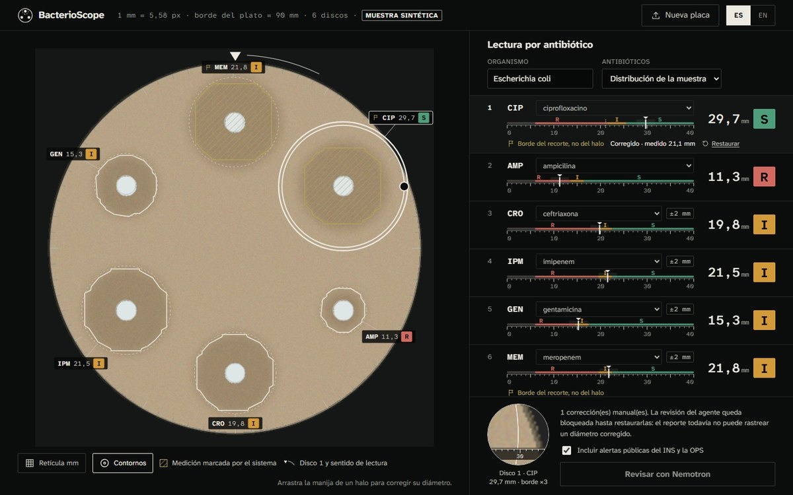

# BacterioScope

[](https://github.com/EstebanHerna/bacterioscope/actions/workflows/ci.yml)
[](https://www.python.org/downloads/)
[](LICENSE)
[-orange.svg)](https://clsi.org)
[](https://innovacion.uniandes.edu.co)

> **"La tecnología al servicio de la salud pública."**

---

**BacterioScope** es un sistema de visión computacional de código abierto que, a partir de una sola fotografía de una placa de antibiograma Kirby-Bauer tomada con cualquier cámara, busca entregar el reporte de sensibilidad/resistencia (S/I/R) completo sin intervención humana: detectar cada disco, leer automáticamente el antibiótico impreso, medir la zona de inhibición en mm y clasificarla según CLSI. Pensado para laboratorios de mediana y baja complejidad en América Latina sin acceso a VITEK/MicroScan.

**Estado actual, no la visión de arriba:** hoy el sistema detecta cada disco de forma confiable (Hough) y mide la zona (Otsu con exclusión del disco, ver Fase 3), pero la lectura automática del antibiótico impreso todavía no es usable en producción (ver Fase 2) — la identidad del antibiótico se resuelve manualmente o por posición de panel fijo, que sí funciona hoy. Ver [`docs/LIMITACIONES.md`](docs/LIMITACIONES.md) para el detalle completo.

Selected for the **Biodiscovery Design Innovation Challenge (BDIC) 2026** — Universidad de los Andes / Nodo de Innovación.

---

## The problem

Antimicrobial resistance (AMR) is one of the leading public health threats of the 21st century. In Latin America, most clinical microbiology laboratories rely on the Kirby-Bauer disk diffusion test as their primary susceptibility method — a technique that is affordable and standardized, but whose final step (measuring inhibition zone diameters with a hand ruler and looking up breakpoints in a printed table) is slow, operator-dependent, and subject to human error.

Automated susceptibility systems (VITEK 2, BD Phoenix, MicroScan) cost upward of USD 80 000 and require continuous reagent supply chains that many hospitals in the region cannot sustain. The result: variable, delayed AST reports that slow appropriate antibiotic prescribing.

BacterioScope eliminates the manual measurement step by turning any camera into a calibrated measuring device.

---

## How it works

```
Photograph of plate (JPEG / PNG / TIFF)
    |
    v
 1. CALIBRATION      Detects the plate rim with Hough Circle Transform.
    |                Computes px/mm using the 90 mm plate diameter so all
    |                measurements are in real physical units.
    v
 2. DISK DETECTION   Locates each antibiotic disk.
    |                Phase 0: HoughCircles geometric fallback.
    |                Phase 2: YOLOv8 detects each disk AND reads the printed
    |                antibiotic label — no manual assignment needed.
    v
 3. ZONE SEGMENTATION  Crops an ROI around each disk, applies Otsu
    |                  thresholding to separate the inhibition zone from
    |                  the bacterial lawn, fits a contour, and reports
    |                  the zone diameter in mm.
    v
 4. CLASSIFICATION   Looks up the antibiotic in the CLSI M100-Ed33 (2023)
    |                breakpoint table and assigns S / I / R.
    v
 5. REPORT           Annotated image + JSON result + downloadable report.
```

### What S, I, R mean

| Category | Full name | Clinical meaning |
|---|---|---|
| **S** | Susceptible | Standard dosing expected to be effective. |
| **I** | Intermediate | May work at higher doses or at sites where the drug concentrates. |
| **R** | Resistant | Unlikely to work at achievable concentrations. Choose a different drug. |

---

## Current state — Phase 0 complete

The end-to-end pipeline is fully operational on the Hough + Otsu baseline.

| Component | Status |
|---|---|
| Plate calibration (px/mm via Hough rim detection) | Complete |
| Disk detection — HoughCircles fallback | Complete |
| Zone segmentation — Otsu + watershed + contour fitting | Complete |
| CLSI M100-Ed33 2023 classifier — 15 antibiotics, Enterobacteriaceae | Complete |
| Streamlit demo (upload image, assign antibiotic, live S/I/R) | Complete |
| Command-line interface (Typer + Rich) | Complete |
| REST API (FastAPI, `/health` + `/analyze`) | Complete |
| Clinical evaluation module (CA, EA, VME, ME, mE — ISO 20776-2) | Complete |
| Panel configuration (auto angular assignment from YAML, or manual per-disk) | Complete |
| HTML report export (self-contained, 9-section scientific report, print-to-PDF) | Complete |
| Batch processing script (`cepa_replica_condicion.jpg` naming, CSV + error log, timing summary) | Complete |
| Design system (Clinical Slate palette, CSS custom properties, dark/light mode) | Complete |
| Traceability (analysis_id UUID, image SHA-256, commit hash, CLSI edition, stage timings) | Complete |
| Bland-Altman measurement accuracy analysis (`scripts/validate_measurement.py`) | Complete |
| Test suite | 261 tests, 94.9% coverage |
| CI (GitHub Actions) | Green on Python 3.10, 3.11, 3.12 |
| Static analysis | ruff, mypy strict, bandit, gitleaks |

**Phase 0 limitation:** disk detection uses geometric circles (no ML) and the antibiotic name is assigned manually in the UI. Phases 2 and 3 remove both constraints.

---

## Roadmap

See [docs/ROADMAP.md](docs/ROADMAP.md) for full detail. See [docs/RESUMEN_EVALUADORES.md](docs/RESUMEN_EVALUADORES.md) for the BDIC 2026 evaluator summary (Spanish). See [docs/METODOLOGIA_Y_HERRAMIENTAS.md](docs/METODOLOGIA_Y_HERRAMIENTAS.md) for methodology and tools. See [docs/STATE_OF_THE_ART.md](docs/STATE_OF_THE_ART.md) for how BacterioScope compares to existing AST systems and published research. See [docs/LIMITACIONES.md](docs/LIMITACIONES.md) for explicit known limitations, [docs/FUENTES_DATOS.md](docs/FUENTES_DATOS.md) for dataset provenance, and [docs/SECURITY_AUDIT.md](docs/SECURITY_AUDIT.md) for the security review.

| Phase | Scope | Status |
|---|---|---|
| **F0** | End-to-end pipeline, Hough baseline, CLSI classifier, Streamlit demo, CLI, API, evaluation module, panel configuration, scientific HTML reports, batch processing, design system, traceability, 261 tests, CI | **Complete** |
| **F1** | Curate and annotate the Dryad/UZH public dataset (225 Gram-negative isolates with clinical ground truth) | Planned |
| **F2** | Train YOLOv8 to detect each disk and read its printed antibiotic label — eliminates manual assignment. Roboflow KB-AST dataset ready (102 train images, 29 antibiotic disk classes), label→CLSI mapping complete, GPU training pending. | **In Progress** |
| **F3** | Calibrate mm measurement using the 6 mm disk as physical reference; validate EA >=90%, CA >=90%, VME <=1.5% | Planned |
| **F4** | Open-source packaging, public deployable demo, peer-reviewed documentation | Planned |

---

## Evaluation of the agent and the synthetic benchmark

`docs/EVALUATION_REPORT.md` holds two kinds of results, both regenerated by `scripts/run_evaluation.py`:
- **Synthetic benchmark:** 8 plates with known geometry, covering detection, mm error, and every category disagreement.
- **Live agent on Nebius Token Factory:** routed vs Ultra-only, with real tokens and latency per review. The first run produced 16/16 reviews that are grounded and validated against their evidence.

These are synthetic plates. The section below covers real photos.

## Validation against real clinical isolates

BacterioScope is validated against the **Dryad/UZH SIRscan dataset** (Egli et al., 2023):
225 Gram-negative clinical isolates photographed with a standardised setup and measured
by the SIRscan automated reader under EUCAST 2023 breakpoints.

### Measurement accuracy (80-image real-photo subset)

| Metric | Identity-matched (20 images, 316 pairs) | Rank-order (59 images, 943 pairs) | Target |
|---|---|---|---|
| Essential Agreement (EA, ±2 mm) | 32.9% | 38.1% | ≥ 90% |
| Mean Absolute Error (MAE, mm) | 6.28 mm | 3.93 mm | — |
| Pearson r | 0.193 | 0.783 | — |

**BacterioScope does not yet meet the ISO 20776-2 / EUCAST target on real, unconstrained
clinical photographs.** Identity matching (each disk paired to its reference by the
antibiotic printed on it, human-verified) is the defensible number; rank-order pairing
is reported only as an optimistic upper bound, not a measurement — see
[docs/VALIDATION_REPORT.md](docs/VALIDATION_REPORT.md) for why the two differ and read
the full diagnostic write-up. Zone segmentation now splits confluent (touching/overlapping)
zones with a Voronoi partition instead of one shared Otsu blob — verified correct on a
controlled case with two genuinely different zone sizes — but several adjacent disk pairs
on the densest real UZH plates (16 disks on one 90mm plate) turned out to have **zero
recoverable boundary signal in the photograph itself** (checked directly: flat pixel
intensity across the entire gap between two disks). No segmentation algorithm can recover
information a fully confluent photograph never captured — a routine clinical panel with
properly spaced disks (6-12, not 16 packed onto one plate) should confluence far less
often, but this has not yet been measured directly.

> **Note on standards**: the UZH reference uses EUCAST 2023 breakpoints; BacterioScope
> classifies using CLSI M100-Ed33 2023. Only measurement accuracy (mm) is compared in
> this phase. Full S/I/R validation against a CLSI-annotated reference is planned for Phase 3.
> See [docs/VALIDATION_REPORT.md](docs/VALIDATION_REPORT.md) for full methodology.

### Objective classification targets (Phase 3)

| Metric | Description | Target |
|---|---|---|
| **EA** | Essential Agreement — measured diameter within ±2 mm of reference | >= 90% |
| **CA** | Categorical Agreement — predicted S/I/R matches reference | >= 90% |
| **VME** | Very Major Error — predicted S when true is R | <= 1.5% |
| **ME** | Major Error — predicted R when true is S | <= 3% |
| **mE** | Minor Error — any discordance involving I | <= 10% |

Definitions per ISO 20776-2 / FDA criteria for AST systems.

---

## Light-box web app



The main interface is a reading screen served by the FastAPI app itself (no separate front-end build):

```bash
pip install -e ".[api,agent]"
uvicorn bacterioscope.api.routes:app --port 8000
```

Open `http://localhost:8000`. The screen is a black reading box (CLSI M02 reads plates against a black, non-reflective background):

- **Every zone is drawn on the photograph.** Each one gets its contour, the measured caliper circle, and a tag with code, diameter and S/I/R. Measurements the system does not trust are hatched in olive.
- **One ruler per antibiotic.** Each ruler shows its CLSI M100-Ed33 R/I/S segments, the measured diameter, and a ±2 mm band that marks readings close to a breakpoint.
- **Corrections are drag-to-fix.** Drag a zone's handle, or use the arrow keys, to correct its diameter. The category recomputes live, and the server confirms it. A 3× loupe on the zone edge carries its own millimetre scale. Every correction is traced, and the agent review stays blocked until corrections are restored, because the report cannot yet trace a corrected diameter.
- **Review with Nemotron** produces a narrative validated against the evidence. Without a Nebius key it falls back to the complete deterministic report. The INS/OPS public alerts are optional. The reviewer signs, then downloads the JSON report.
- **The interface is bilingual (ES/EN)** and works on a phone.

Direct links for demos:

| Link | What it opens |
|---|---|
| `/?sample=plate_mixed_sir&lang=es` | Synthetic 6-disk plate, Spanish |
| `/?sample=real_plate_box4&lang=en` | Real 16-disk photograph, English |
| `/?sample=plate_esbl_like&lang=es&review=1` | Synthetic plate with the review already run |

The same image runs with Docker: `docker build -t bacterioscope . && docker run -p 8000:8000 --env-file .env bacterioscope`.

## Try the Streamlit prototype

```bash
git clone https://github.com/EstebanHerna/bacterioscope.git
cd bacterioscope
pip install -e ".[all,dev]"
streamlit run src/bacterioscope/app.py
```

Opens at `http://localhost:8501`. Upload a plate photograph or click **Load example image** to analyse the built-in synthetic plate. Choose a fixed panel from the sidebar for automatic antibiotic assignment, or keep the default manual per-disk mode.

## Test provider connections locally

The local provider smoke check reads `.env` and never prints API keys. Install the
agent extra, then run it from the repository root:

```bash
python -m pip install -e ".[agent]"
python scripts/smoke_test_integrations.py
```

The default run lists the Nemotron models visible to the configured Nebius
account and makes one fixed, public Tavily search for each of INS and OPS. Use
`--skip-tavily` to avoid those two search requests. Add `--check-inference` to
send one short, non-clinical prompt to the configured Nano model; this makes a
small billable inference request. The script sends no plate images, isolate
identifiers, or AST results to either provider.

To run the complete local demo (synthetic plate analysis → rule tools → optional
INS/OPS searches → Nemotron → validated report), run:

```bash
python scripts/demo_agent_review.py
```

This makes a small model request and up to two Tavily searches. Use
`--skip-alerts` to avoid the searches. The default sample is generated and
non-identifiable; custom images require manually supplied disk names with
`--antibiotics` in clockwise order from 12 o'clock. Disk identity remains a
human input. The report is a demo for microbiologist review, not a clinical
result.

Set `NEBIUS_API_KEY`, `TAVILY_API_KEY`, and the exact account-visible model IDs
(`NEBIUS_MODEL_NANO`, `NEBIUS_MODEL_SUPER`, `NEBIUS_MODEL_ULTRA`) in the local
`.env`. Never commit that file. This smoke check exercises provider access; it
does not imply that the prototype is validated for clinical use. The agent
review panel lives in the light-box web app, not in the Streamlit prototype.

---

## Usage

### Command-line interface

```bash
python -m bacterioscope analyze docs/plate_original.png
python -m bacterioscope analyze plate.jpg --output annotated.jpg
python -m bacterioscope analyze plate.jpg --panel enterobacteria_clsi_12 --report report.html
python -m bacterioscope version
```

The `--panel` flag auto-assigns antibiotic names by clockwise angular position from the 12 o'clock disk. A mismatch between detected disk count and panel size is reported as a warning without silently assigning wrong labels. The `--report` flag writes a self-contained HTML file (open in any browser and Ctrl+P to save as PDF).

### Batch processing

```bash
python scripts/batch_analyze.py data/raw/images/ --output data/processed/ --panel enterobacteria_clsi_12
```

Expects filenames in `cepa_replica_condicion.jpg` format. Writes `results.csv` (one row per disk) and `errors.log`.

### Panel configuration

Panels are YAML files under `panels/` that declare a fixed antibiotic list ordered by clockwise position from 12 o'clock. Two panels are included:

| Panel | Disks | Use case |
|---|---|---|
| `enterobacteria_clsi_12` | 12 | Full Enterobacteriaceae workup |
| `enterobacteria_clsi_6` | 6 | Rapid screening panel |

Custom panels can be added by creating `panels/<name>.yaml` with the same schema.

### REST API

```bash
uvicorn bacterioscope.api.routes:app --reload
curl http://localhost:8000/health
curl -X POST http://localhost:8000/analyze -F "image=@plate.jpg"
```

Interactive API docs at `http://localhost:8000/docs`.

### MCP server

The same workflow is available to MCP clients such as Claude Desktop, Claude Code and other agents. The server runs over stdio by default:

```bash
pip install -e ".[mcp,agent]"
bacterioscope-mcp                                    # stdio
bacterioscope-mcp --transport streamable-http        # http://127.0.0.1:8765/mcp
```

| Tool | What it does |
|---|---|
| `bacterioscope_analyze_plate` | Detects disks on a local photo or bundled sample and measures each zone. Takes antibiotics in clockwise order, or a panel. |
| `bacterioscope_update_plate` | Assigns antibiotics or corrects diameters by clockwise position. A correction blocks the review until it is cleared. |
| `bacterioscope_review_plate` | Runs the grounded Nemotron review (with deterministic fallback), with optional INS/OPS alerts. |
| `bacterioscope_classify_zone` | Classifies one diameter as S/SDD/I/R under CLSI M100-Ed33 for Enterobacterales. |
| `bacterioscope_get_breakpoints` | Returns the breakpoint table used, accepting names or codes (`CIP`, `MEM`, ...). |
| `bacterioscope_list_samples` / `bacterioscope_list_panels` | Lists the bundled sample plates and the fixed disk panels. |

Claude Code: `claude mcp add bacterioscope -- bacterioscope-mcp`. Claude Desktop (`claude_desktop_config.json`):

```json
{ "mcpServers": { "bacterioscope": { "command": "bacterioscope-mcp" } } }
```

The server reads `NEBIUS_API_KEY` and `TAVILY_API_KEY` from the environment or from the repository `.env`. Without them, the review still returns the complete deterministic report. Ten verified evaluation questions live in `docs/MCP_EVALUATION.xml`.

### Python API

```python
from bacterioscope.pipeline import BacterioScopePipeline, PipelineConfig

pipeline = BacterioScopePipeline(PipelineConfig(plate_diameter_mm=90.0))
result = pipeline.analyze("plate.jpg")
for cls in result.classifications:
    print(cls.antibiotic, cls.zone_diameter_mm, cls.category)
```

---

## Repository layout

```
bacterioscope/
├── src/bacterioscope/
│   ├── pipeline.py          <- end-to-end orchestrator (start here)
│   ├── cli.py               <- Typer CLI
│   ├── app.py               <- Streamlit demo
│   ├── _app_logic.py        <- pure helpers (no Streamlit dependency)
│   ├── detection/
│   │   ├── detector.py      <- DiskDetector: YOLOv8 or Hough fallback
│   │   └── train.py         <- YOLOv8 training script (Phase 2)
│   ├── segmentation/
│   │   └── watershed.py     <- ZoneSegmenter: Otsu + contour fitting
│   ├── classification/
│   │   └── clsi.py          <- CLSIClassifier + CLSI 2023 breakpoints
│   ├── evaluation/
│   │   ├── metrics.py       <- CA, EA, VME, ME, mE
│   │   ├── report.py        <- Markdown + HTML report generation
│   │   └── plate_report.py  <- self-contained per-plate HTML report (base64 image)
│   ├── panels/
│   │   └── manager.py       <- PanelManager: load YAML, assign by angular position
│   ├── api/
│   │   ├── routes.py        <- FastAPI endpoints, serves the web app at /
│   │   ├── lab.py           <- light-box API: plates, classify, panel, agent review
│   │   └── schemas.py       <- Pydantic schemas
│   ├── web/                 <- light-box front end (HTML/CSS/JS, no build step)
│   ├── plate_session.py     <- review sessions shared by the web API and the MCP server
│   ├── mcp_server.py        <- MCP server (bacterioscope-mcp)
│   └── utils/
│       ├── calibration.py   <- plate rim detection -> px/mm
│       └── visualization.py <- annotated image output
├── panels/                  <- YAML panel configs (antibiotics by clockwise position)
│   ├── enterobacteria_clsi_12.yaml
│   └── enterobacteria_clsi_6.yaml
├── tests/                   <- 261 tests, mirrors src/ structure
├── scripts/
│   ├── download_data.py        <- Dryad/UZH downloader with manual-step instructions
│   ├── prepare_dataset.py      <- normalise UZH CSV for validation pipeline
│   ├── validate_measurement.py <- EA / MAE / Pearson r vs SIRscan reference
│   ├── evaluate.py             <- batch S/I/R evaluation against labelled CSV
│   ├── batch_analyze.py        <- folder batch processing (results.csv + errors.log)
│   └── generate_demo.py        <- synthetic demo images in docs/
├── docs/
│   ├── ROADMAP.md              <- phased development plan
│   ├── VALIDATION_REPORT.md    <- measurement validation vs UZH SIRscan
│   ├── figures/                <- annotated plates (populate with validate_measurement.py)
│   ├── plate_original.png      <- synthetic test plate
│   └── pipeline_demo.gif       <- animated pipeline walkthrough
├── pyproject.toml           <- all config: deps, ruff, mypy, pytest, bandit
├── Dockerfile               <- non-root production container
└── Makefile                 <- make test / make lint / make demo
```

---

## Dataset

| Dataset | Description | Access |
|---|---|---|
| **Dryad/UZH** (Egli et al., 2023) | 225 Gram-negative isolates, 862 phenotypic categories with SIRscan reference measurements (EUCAST). Primary validation set. | `python scripts/download_data.py` (manual browser step — see script docstring) |
| **Roboflow/KB-AST** | Community-annotated Kirby-Bauer images with disk bounding boxes | Manual download from Roboflow |

### Dataset citation

> Egli A, Imkamp F, Amlang G, Brunner S, Albrich W, et al. (2023).
> *Automated reading of disk diffusion antibiograms.*
> Dryad Digital Repository.
> [https://doi.org/10.5061/dryad.5dv41nsfj](https://doi.org/10.5061/dryad.5dv41nsfj)
> License: CC0 1.0 Universal.

### Validation workflow

```bash
python scripts/download_data.py      # follow the manual download prompt
python scripts/prepare_dataset.py    # normalise reference measurements to CSV
python scripts/validate_measurement.py  # compute EA / MAE / Pearson r
```

Results are written to [docs/VALIDATION_REPORT.md](docs/VALIDATION_REPORT.md).
Annotated plate images are saved in `data/processed/validation_figures/`.

---

## Streamlit Community Cloud deployment

**Live demo:** _not yet deployed — replace this line with the public URL once
the app is connected on [share.streamlit.io](https://share.streamlit.io)._

The repo ships deployment-ready configuration under `.streamlit/config.toml` and `requirements.txt`. To deploy:

1. Push to a GitHub repository.
2. Go to [share.streamlit.io](https://share.streamlit.io), connect the repo, and set the main file to `src/bacterioscope/app.py`.
3. Streamlit Cloud installs `requirements.txt` automatically (includes `-e .`, so the package itself installs correctly — verified directly: without it, the entry point fails with `ModuleNotFoundError` on a fresh install).

The demo runs without YOLOv8 weights (falls back to HoughCircles) and without `ultralytics` installed at all (verified directly: a missing-weights-file case and a missing-`ultralytics`-package case both fall back cleanly, no crash). The built-in example image works immediately after deploy — no upload required to verify the deployment.

---

## Development

```bash
pip install -e ".[dev]"           # core + dev tools
pip install -e ".[all,dev]"       # everything (ML, API, UI)

make test                          # pytest tests/ -v
make lint                          # ruff check src/ tests/
ruff check --fix src/ tests/       # auto-fix style
mypy src/bacterioscope/            # type checking (strict)
bandit -r src/ -c pyproject.toml   # security scan
```

---

## Team

| Role | Member |
|---|---|
| Technical lead / ML | Esteban A. Hernandez Sulvara — Systems Engineering, Uniandes |
| Microbiology | Paula Becerra Lara — Microbiology, Uniandes |
| Interface & data | Santiago Gomez — Uniandes |
| Advisor | Astrid Berena Herrera — Uniandes |

---

## License

MIT — see [LICENSE](LICENSE).

---

*"La tecnología al servicio de la salud pública."*
