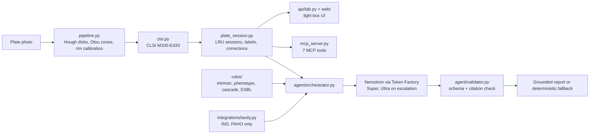

# BacterioScope handoff

For whoever picks this project up: a teammate, a new contributor, or a future coding session.
State as of 2026-10-19, `main` at `749a0d1` (merge of PR #11). Read this first, then
`CLAUDE.md` (binding rules) and `docs/SUBMISSION_KIT.md` (hackathon delivery).

## 1. What this is

BacterioScope reads one photo of a Kirby-Bauer antibiogram plate:
- it detects every disk and measures each inhibition zone in millimetres, calibrated against the 90 mm plate rim;
- it classifies each zone S/I/SDD/R under CLSI M100-Ed33 for Enterobacterales;
- it flags the measurements it does not trust.

A microbiologist reviews and corrects the result on a web screen (the "light box"). Nemotron on
Nebius Token Factory then writes a review that may cite only the deterministic evidence, plus
official INS/PAHO alerts found through Tavily. The same workflow is exposed as an MCP server.

It is decision support with mandatory human sign-off, not an automated reader:
- real-photo measurement agreement is 32.9%, against a 90% clinical target;
- antibiotic identity comes from manual or panel assignment, not from reading the disk.

Context: Nebius x NVIDIA hackathon (submit by Thu 29 Oct 2026). The project is also selected for
the Uniandes BDIC 2026.

## 2. Get it running (10 minutes)

```bash
git clone https://github.com/EstebanHerna/bacterioscope.git && cd bacterioscope
python -m pip install -e ".[api,agent,mcp,dev]"     # Python 3.10-3.12
cp .env.example .env                                # then fill NEBIUS_API_KEY and TAVILY_API_KEY
uvicorn bacterioscope.api.routes:app --port 8000    # open http://localhost:8000/
```

| Want to | Run |
|---|---|
| Open a demo plate directly | `http://localhost:8000/?sample=plate_mixed_sir&lang=es` (real photo: `sample=real_plate_box4`; add `&review=1` to run the review on load) |
| Use the MCP server | `bacterioscope-mcp`, or `claude mcp add bacterioscope -- bacterioscope-mcp` |
| Check provider keys | `python scripts/smoke_test_integrations.py` |
| Run the benchmark (no network) | `python scripts/run_evaluation.py` |
| Run the live agent evaluation (billable) | `gh workflow run "Agent evaluation"` |
| Run every gate | `ruff check src/ tests/ && mypy src/bacterioscope/ && bandit -r src/bacterioscope/ -c pyproject.toml && pytest tests/` |
| Run in Docker | `docker build -t bacterioscope . && docker run -p 8000:8000 --env-file .env bacterioscope` |

Without keys everything still works: the review returns the complete deterministic report with
`status: fallback` and `fallback_reason: token_factory_unavailable`.

## 3. How it fits together



| Path | Responsibility |
|---|---|
| `src/bacterioscope/pipeline.py` | Orchestrates calibration, detection, segmentation and classification for one image. |
| `detection/detector.py`, `segmentation/watershed.py`, `utils/calibration.py` | Hough disks, Otsu zones that exclude the disk, Voronoi split, plate-rim px/mm. |
| `classification/clsi.py` | CLSI M100-Ed33 breakpoints and whole-mm rounding. |
| `panels/manager.py` + `panels/*.yaml` | Antibiotic assignment by clockwise position from 12 o'clock. |
| `plate_session.py` | Review sessions shared by the web API and MCP: 48-entry in-memory LRU, labels, traced corrections, agent review. Raises domain errors only. |
| `api/routes.py`, `api/lab.py` | FastAPI: `/analyze` (stable contract), `/api/*` for the light box, strict CSP, serves `web/` at `/`. |
| `web/` | Light-box front end (no build step). The CSP forbids inline styles, so `app.js` sets styles through CSSOM. |
| `mcp_server.py` | FastMCP server; disks are addressed by clockwise position; names or codes (`CIP`, `MEM`). |
| `agent/` | Token Factory client, routing, prompts, orchestrator, validator against `docs/contracts/agent-review-v1.schema.json`. |
| `rules/` | Rule engine, ESBL screen, CLSI Ed33/Ed36 rule catalogs (empty or draft until reviewed). |
| `integrations/tavily.py` | Alert search restricted to `ins.gov.co` and `paho.org`. |
| `evaluation/` | ISO 20776-2 metrics, synthetic benchmark, agent benchmark. |
| `scripts/run_evaluation.py` | Writes `evaluation_results.json` and `EVALUATION_REPORT.md`; `--live-results` re-renders a CI run. |
| `app.py` | Older Streamlit prototype; the light box replaces it for the demo. |

## 4. Accounts, keys and secrets

| Item | Where | Notes |
|---|---|---|
| `NEBIUS_API_KEY` | Local `.env` (gitignored); GitHub repo secret | Token Factory key on Esteban's account, which carries the hackathon promo credit. The promo code is not the key. |
| `TAVILY_API_KEY` | Local `.env`; GitHub repo secret | Free tier with about USD 25 of quota. |
| `NEBIUS_MODEL_NANO/SUPER/ULTRA` | Optional env vars or repo variables (none set today) | Tier models are resolved from the live catalog; set one only if resolution becomes ambiguous. |
| GitHub repo | `EstebanHerna/bacterioscope` (owner Esteban; Luis has write access) | Personal repo: admin rights cannot be granted to collaborators. |

Never commit `.env`, never paste keys in chat or screenshots, and keep `.env` closed while
recording the video. CI runs gitleaks on every push.

## 5. CI and quality gates

- **`ci.yml`** runs on push and PR:
  - tests on Python 3.10/3.11/3.12 (ruff, bandit, mypy strict, pytest with coverage >= 80%);
  - a Docker build that also imports the API and runs the benchmark inside the image;
  - pip-audit and gitleaks.
- **`codeql.yml`** runs on push and PR to `main`, and weekly.
- **`agent-eval.yml`** is manual only and billable. It runs the live evaluation with the repo secrets and uploads `evaluation_results.json` and `EVALUATION_REPORT.md` as an artifact.
- **Last state:** 513 tests pass, coverage 91.7%; every check is green on PR #10 and PR #11.
- **Working rules** (from `CLAUDE.md`):
  - commit messages in Spanish, with no AI co-author lines;
  - code and docs in English;
  - no emojis;
  - functions under 40 lines;
  - type hints and Google docstrings.

## 6. Numbers we can stand behind

| Result | Value | Source |
|---|---|---|
| Live agent reviews grounded and validated | 16/16 (8 routed, 8 Ultra-only), median about 2.5 s | `docs/EVALUATION_REPORT.md`, Actions run 39275126717 |
| Routed vs Ultra output tokens | 0.74x, with the same grounded rate | same |
| Disks detected, synthetic plates | 54/54, exact count on 8/8 | same, Stage 1 |
| Very major + major errors on unflagged disks | 0 of 28 (all 3 are on flagged disks of the 12-disk plate) | same |
| Real-photo essential agreement (±2 mm) | 32.9% on 20 identity-matched images, 316 pairs | `docs/VALIDATION_REPORT.md` |

Never present synthetic numbers or the Ed33-derived UZH labels as clinical validation.

## 7. Decisions that bind future work

- **Calibration** uses the plate rim, not the 6 mm disk. Disk calibration was measured and is worse (`CLAUDE.md`, F3).
- **No temporal prediction:** one static photo after incubation.
- **Disk-label reading** (29-class YOLO) is not usable. Identity comes from manual or panel assignment, which works today.
- **The model never sees the image.** It receives structured evidence only, and every citation must exist in that evidence.
- **A manual zone correction blocks the agent review** (HTTP 409, MCP tool error) until it is cleared, because the report contract cannot trace a corrected diameter yet.
- **Rule catalog:**
  - The expert-rule catalog stays empty until a microbiologist reviews its sources. Never invent rules to make the demo look richer.
  - Because the catalog is empty, routing currently never escalates to Ultra.
- **Synthetic samples** are always labelled as synthetic in the UI and the report.
- **Web security:** the web app runs under a strict CSP with no `unsafe-inline`. Keep it that way.

## 8. Known limits and gotchas

- **Sessions live in process memory** (an LRU of 48). They are lost on restart and not shared between workers, so deploy with a single uvicorn worker (the Docker default).
- **Dense plates:** on the 16- and 12-disk plates, neighbouring zones merge and errors concentrate there.
- **The UZH validation set** uses square plates that fill the frame, so plate-rim calibration is unreliable on it (`docs/LIMITACIONES.md` section 9).
- **Cost is not reported**: the Nebius pricing page needs a login. Pass `--prices prices.json` to `run_evaluation.py` with prices copied from the console.
- **A public demo spends Token Factory credit** on every review. Keep alerts optional and watch usage.
- **Windows:** git prints LF/CRLF warnings and a `credential-manager-core` warning on push; both are harmless.

## 9. Open work

| Task | Owner | Due |
|---|---|---|
| Public deployment of the Docker image with keys as platform secrets | Sebastian, with Esteban | Fri 23 Oct |
| Architecture diagram (start from section 3) | Sebastian | Sat 24 Oct |
| Review the CLSI breakpoints and the demo wording | Paula | Sat 24 Oct |
| Review and enable a small, sourced subset of expert rules, if Paula signs off | Luis + Paula | before freeze |
| Feature freeze: fixes and docs only | All | Mon 26 Oct |
| Video and Devpost (script and text in `SUBMISSION_KIT.md`) | Sebastian | Wed 28 Oct |
| Submit | Esteban | Thu 29 Oct |

After the hackathon:
- automatic disk-label reading (F2);
- a better split of confluent zones;
- a persistent session store for multi-worker deployments;
- a supervised pilot with a Colombian lab.

Merged branches that can be deleted when convenient: `feat/eval`, `feat/eval-report`,
`feat/agent`, `feat/agent-orchestration`, `feat/rules`, `feat/p2-integration-hardening`,
`feat/p2-ed33-groundtruth`, `docs/freeze-lab-review-harness`, `docs/post-merge-p2-harness`.

## 10. Team

| Person | Role |
|---|---|
| Esteban Hernandez | Technical lead, agent core (P1). Did evaluation (P3) and the UI (P4) for the hackathon. |
| Luis Sebastian Contreras | Rule tools and integration (P2). |
| Daniel | Evaluation and Nebius infrastructure (P3, open). |
| Sebastian | Product and delivery: deployment, video, Devpost (P4 delivery). |
| Paula Becerra | Microbiology review. |

## 11. Where to read more

| Question | Document |
|---|---|
| Binding rules, phase history, measured findings | `CLAUDE.md` |
| Hackathon delivery: video script, Devpost text, claims | `docs/SUBMISSION_KIT.md` |
| Evaluation results | `docs/EVALUATION_REPORT.md` |
| Real-photo validation | `docs/VALIDATION_REPORT.md` |
| Limitations | `docs/LIMITACIONES.md` |
| Agent design and routing | `docs/AGENT_ARCHITECTURE.md` |
| Rule sources and inventory | `docs/PERSON_2_RULE_SPEC.md`, `docs/CLSI_ED36_RULE_INVENTORY.md` |
| UI design system | `DESIGN.md` |
| Team plan and calendar | `docs/TEAM_EXECUTION_PLAN.md` |
| MCP evaluation questions | `docs/MCP_EVALUATION.xml` |
