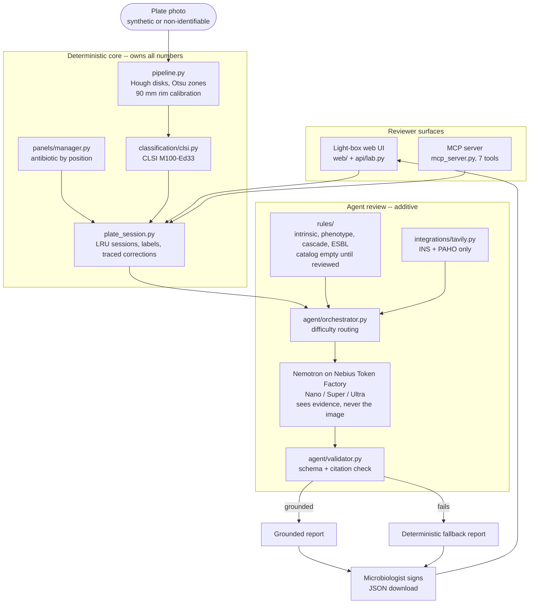

# Architecture diagram (Persona 4)

The submission architecture diagram. The Mermaid source below is the canonical
version; export it to PNG/SVG for the Devpost page and the video. It reflects
the shipped system (see `docs/HANDOFF.md` section 3 for the module map).

## Key boundaries the diagram must preserve

- **Deterministic code owns the numbers.** Measurements, S/I/SDD/R categories,
  rule conditions, cascade output, and source validation are computed in code.
- **The model never sees the image.** Nemotron receives structured evidence
  only and may cite only evidence ids that exist.
- **The validator gates the narrative.** A reply that breaks the schema or cites
  missing evidence falls back to the complete deterministic report.
- **Tavily is fixed and narrow.** Only `ins.gov.co` and `paho.org`, broad AMR
  queries, no isolate or patient data.
- **Human sign-off is mandatory.** A microbiologist reviews and signs; a manual
  zone correction blocks the review until cleared.

## Diagram source (Mermaid)

## Component ownership

| Block | Owner | Note |
|---|---|---|
| Deterministic core | P1 pipeline + P2 rules/classifier | Numbers and categories |
| Agent review | P1 agent core, P2 rule tools and Tavily | Nemotron summarizes supplied evidence only |
| Reviewer surfaces | P4 (UI delivery), P1 contract | Light box and MCP |
| Validator and schema | P1 | `docs/contracts/agent-review-v1.schema.json` |

## Export steps

1. Render the Mermaid block with the Mermaid CLI or the Mermaid Live Editor.
2. Export both an SVG (for the Devpost page) and a 1920-wide PNG (for the video).
3. Keep the exported files out of git unless the team decides to commit them;
   this document is the canonical source.

## Caption for the submission

"One photo goes in. Deterministic code measures and classifies it; Nemotron
writes a review that may cite only the evidence it was given; the validator
drops any ungrounded narrative to a deterministic fallback; a microbiologist
signs. The model never sees the image."
